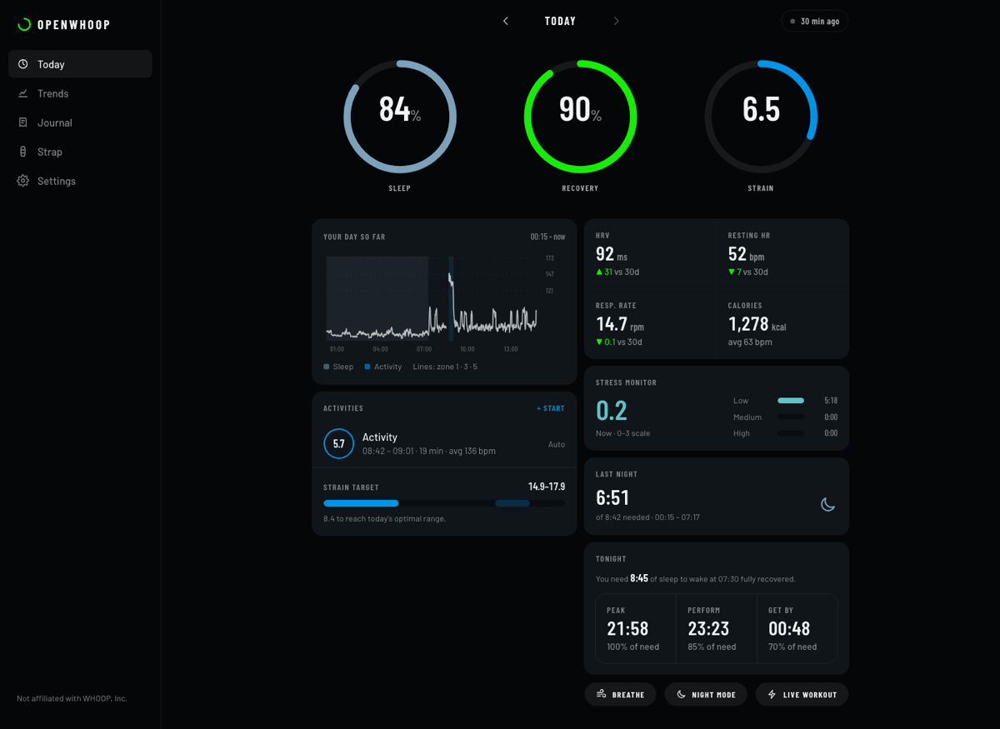
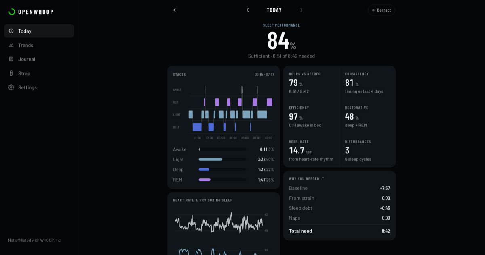
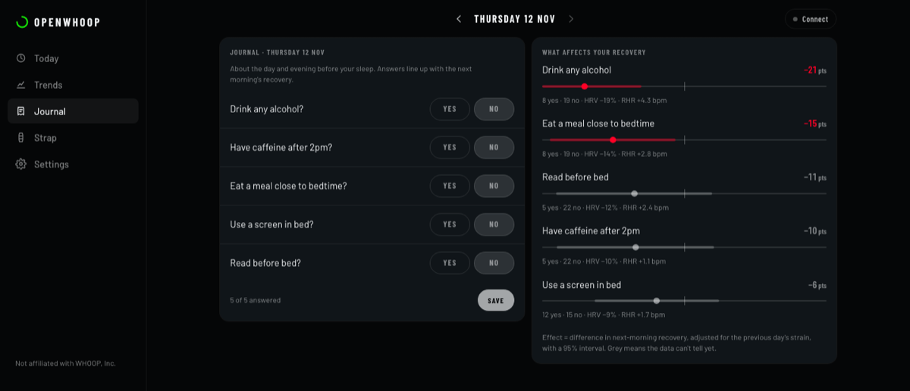

# OpenWhoop

Your WHOOP 4.0, scored on your own machine. OpenWhoop reads the strap over
Bluetooth from the browser, computes recovery, sleep, strain and stress with
models calibrated against real WHOOP data, and shows them in a familiar
three-dial dashboard. Run it on your laptop, or host your own instance behind a
password.



> Independent open-source project. Not affiliated with, endorsed by or
> connected to WHOOP, Inc. Scores are estimates for personal insight, not
> medical advice.

## What you get

- **Recovery, sleep, strain and stress.** These are models fitted to 4,000+
  nights of real WHOOP exports. On people the model never saw, recovery tracks
  WHOOP's own score day to day with a median correlation of 0.93. How each
  score works, and how well it matches: [docs/algorithms.md](docs/algorithms.md).
- **Sleep staging, sleep need, debt, consistency, and a sleep planner** that
  tells you when to go to bed.
- **A smart haptic alarm** that wakes you in light sleep inside your window,
  once your sleep goal is met or you're "in the green". The strap's own alarm
  is set as a backup.
- **Haptic automations** while the strap is connected:
  - a nudge when stress stays high
  - two taps when you hit today's strain target
  - a bedtime buzz
  - double-tap the strap to start paced breathing with live HRV
- **A journal with insights** that shows how alcohol, late meals, screens and
  your own custom questions move your recovery, with confidence intervals.
- **Live workouts** with live strain and heart-rate zones.
- **Companion mode.** Keep using the official WHOOP app: OpenWhoop reads
  without freeing the strap's memory, can import WHOOP's own scores to show
  next to yours, and calibrates itself to you.
- **Open integrations:**
  - Strava import, plus optional strain in your activity descriptions
  - signed webhooks
  - scoped API tokens
  - WHOOP-format CSV export

  See [docs/integrations.md](docs/integrations.md).
- **Your data stays with you.** One SQLite file. The raw strap bytes are
  archived, so data can be re-decoded as the protocol is better understood.

| | |
|---|---|
|  |  |

## Quick start

You need Node 22.18 or newer, and Chrome or Edge on a computer or an Android
phone (for Web Bluetooth).

```bash
npm install
npm run build
npm start            # → http://localhost:8787
```

Open it, go to **Strap → Connect**, and pick your WHOOP. Quit the official app
first, or turn off your phone's Bluetooth: the strap talks to one device at a
time. Your first recovery appears after three nights.

**No strap at hand?** `npm run demo` starts the app on 45 days of simulated
data in `./data-demo`. Your real data directory is never touched.

## On your phone

OpenWhoop is an installable web app (PWA):

- **Android (Chrome):** open your instance, then menu → *Install app*.
  Everything works, including Bluetooth sync, the alarm and haptics.
- **iPhone:** *Share → Add to Home Screen* installs the dashboard, which is
  fine for checking your scores. Safari has no Web Bluetooth, so the strap
  can't sync from an iPhone. Sync from a computer, an Android phone, or the
  Bluefy browser on iOS, which supports Web Bluetooth.

## Self-hosting

```bash
docker compose up -d   # then open the setup link from `docker compose logs`
```

Railway, Fly.io and VPS + Caddy recipes are in
[docs/self-hosting.md](docs/self-hosting.md). A hosted instance needs HTTPS so
the browser allows Bluetooth.

## How it works

```
Browser (Web Bluetooth)  ──frames──▶  Server (Node + SQLite)  ──▶  Web app
  reassembles packets,              archives raw frames,          dials, charts,
  uploads each batch,               decodes 1 Hz records,         journal, modes
  acks only after it's stored       scores sleeps/cycles
  (or never, in companion mode)     webhooks · integrations · API
```

- Protocol notes, test vectors and known unknowns: [docs/protocol.md](docs/protocol.md)
- Score models and their sources: [docs/algorithms.md](docs/algorithms.md)
- Fit report: [docs/calibration.md](docs/calibration.md). Re-run it on your own
  WHOOP export with `npm run calibrate -- <folder> --write`.

## Development

```bash
npm run dev        # API on :8787 with --watch, Vite on :5173
npm test           # protocol, algorithms, pipeline, API
npm run check      # typecheck + tests + build
```

Contributor and agent guide: [AGENTS.md](AGENTS.md).

## Limitations

- WHOOP 4.0 only. The 5.0/MG strap uses different framing and record versions
  (documented in [docs/protocol.md](docs/protocol.md)). Not supported yet.
- No SpO₂ on 4.0: the raw channels don't separate red from IR. Skin
  temperature is shown as a deviation, and is experimental.
- Sleep staging is physiology-based, not trained on lab sleep studies.
- Syncing runs at the strap's pace, about 10 records per second. Use **Keep
  syncing** to stay current instead of catching up on days at once.

## Credits

Built on reverse-engineering work by:
- [bWanShiTong/openwhoop](https://github.com/bWanShiTong/openwhoop) and the [reverse-engineering write-up](https://github.com/bWanShiTong/reverse-engineering-whoop-post)
- [jogolden/whoomp](https://github.com/jogolden/whoomp)
- [OpenStrap](https://github.com/OpenStrap/protocol)
- [noop](https://github.com/ryanbr/noop)

Calibration data credits are in [docs/algorithms.md](docs/algorithms.md#data).
